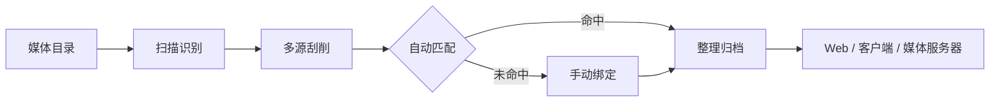
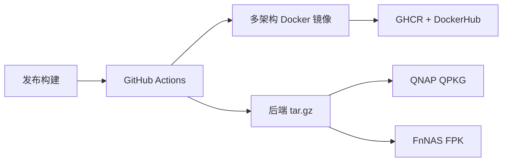

<div align="center">


# AMMDS

**私有化媒体数据管理平台 · 发布仓库**

[](https://github.com/MengSenStudio/AMMDS-Docker/releases)
[](https://github.com/MengSenStudio/AMMDS-Docker/pkgs/container/ammds)
[](https://hub.docker.com/r/qyg2297248353/ammds)
[](https://ammds.lifebus.top/)
[](https://store.lifebus.top/)

[文档](https://ammds.lifebus.top/) ·
[Releases](https://github.com/MengSenStudio/AMMDS-Docker/releases) ·
[开放 API](AMMDS-API.md)

</div>

> [!IMPORTANT]
> 请勿在中国大陆宣传、推广或公开分享本产品。需要提及时请使用简称 `AMMDS`。

> [!WARNING]
> AMMDS 是**离线产品**：不主动抓取、不内置数据源，数据由使用者手动录入或通过自建插件获取。
> 使用本产品产生的内容与数据由使用者自行负责。

## ✨ 这是什么

AMMDS（Adult Movie MetaData Scraper）是一个面向个人影视库的私有化数据管理平台：

- 🎬 影视库、演员、标签与评分管理
- 🔌 多源插件与媒体服务器集成
- 🖼️ 封面生成、图片处理与元数据刮削
- 📱 Web 管理端 + Flutter 客户端 + Mihon 扩展

本仓库只负责 **交付**：提供可直接运行的镜像和离线安装包。

## 🔍 扫描 · 刮削 · 整理

AMMDS 把散落在硬盘里的视频，变成媒体服务器能识别、你能搜索和浏览的影视库。



### 1️⃣ 扫描：先把文件认出来

- 添加一个或多个媒体目录，创建**手动或定时扫描任务**；
- 扫描阶段只建立媒体记录，不会移动原文件，整理阶段才按规则搬运；
- 自动识别常见命名：

| 类型 | 可识别示例 |
| :-- | :-- |
| JAV 番号 | `ABC-123`、`ABP-456`、`FC2-PPV-1234567` |
| 欧美番号 | `Deeper.2025.06.05`、`TushyRaw-25-5-7` |
| 剧集 | `Show.S01E01`、`剧名.第1季第3集`、`Show.SP01` |
| 综艺 / 日期型 | `Show.2026.01.05`、`Show.26.01.05` |

- 支持字符过滤、品牌前缀过滤、番号补全，减少 `1080p`、站点水印等干扰；
- 在「扫描记录」里检查识别结果、重试失败文件，或手动绑定到已有影片。

<details>
<summary><b>文件命名太乱，识别不到怎么办？</b></summary>

1. 先确认文件名里保留了番号或剧名；
2. 在扫描任务里配置字符过滤和品牌前缀，剔除站点后缀、画质标记；
3. 仍然失败时，可在扫描记录中手动绑定；绑定成功后同样进入刮削和整理流程；
4. 已经整理好的媒体库，可使用「查漏补缺」模式，不移动文件，只补缺失的图片和 NFO。

</details>

### 2️⃣ 刮削：把信息补全

一个文件进入刮削后，会走一条固定的流水线：

| 步骤 | 做什么 |
| :-- | :-- |
| 文件校验 | 检查文件、任务配置和重复刮削 |
| 番号识别 | 从文件名提取番号 / 剧集坐标 |
| 多源检索 | 并发查询所有已启用的数据源 |
| 结果匹配 | 按本地库记录回读并绑定影片 |
| 演员刮削 | 补全演员资料、头像和作品关系 |
| 整理落盘 | 按模板搬运文件并写入 NFO、图片、字幕 |

- 数据源按需启用，可自由排序：MetaTube、ThePornDB、Stash、FANZA DMM、M-Team DMM、TheJavDB、R18Dev、TMDB；剧集支持 TMDB、TheTVDB、Bangumi；
- 可开启「本地优先」，优先读取已有 NFO 和人工维护的数据；
- 多源并发检索，单个数据源失败不会阻塞其他源；匹配不到时可手动绑定；
- 自动刮削可配合定时任务运行，失败次数达到上限后自动忽略，手动绑定可复位；
- 刮削结果不仅是文字：还包括封面、背景图、缩略图、剧照、外挂字幕和 NFO。

### 3️⃣ 整理：按你的规则落盘

整理阶段决定文件最终长什么样：

- 目录模板默认 `${actor}/${number}`，文件名模板默认 `${number}`；
- 支持 `${actor}`、`${number}`、`${title}`、`${date}`、`${year}`、`${studio}`、`${resolution}` 等占位符；
- 自动生成 Kodi / Jellyfin / Emby 可识别的 NFO 与图片；
- 可自动写入分辨率、制作商、发行日期、演员、马赛克、中文字幕等标签；
- 「查漏补缺」模式会保持现有目录和文件名，只补齐缺失的图片、NFO 字段和标签，不覆盖你已有的内容。

```text
媒体库/
└── 演员名/
    └── ABC-123/
        ├── ABC-123.mp4
        ├── ABC-123.nfo
        ├── ABC-123-poster.jpg
        ├── ABC-123-fanart.jpg
        ├── ABC-123-thumb.jpg
        └── extrafanart/
            ├── fanart1.jpg
            └── fanart2.jpg
```

> [!TIP]
> 第一次使用建议先用少量文件验证目录模板和命名规则，确认无误后再批量整理。

## 📦 发布内容

| 产物 | 说明 | 获取方式 |
| :-- | :-- | :-- |
| Docker 镜像 | `linux/amd64`、`linux/arm64` 多架构镜像 | `ghcr.io/mengsenstudio/ammds` / DockerHub |
| OL8 镜像 | 兼容 Oracle Linux 8 的镜像变体 | 追加 `-ol8` 标签 |
| 后端产物 | `ammds-amd64-backend.tar.gz`、`ammds-arm64-backend.tar.gz` | [Releases](https://github.com/MengSenStudio/AMMDS-Docker/releases) |
| 工具依赖 | ffmpeg、ffprobe、videohashes、MetaTube、VibeVoice、WinRAR 等 | `software-25.05.12` Release |
| 离线安装包 | QNAP `.qpkg`、FnNAS `.fpk` | 由 [AMMDS-Offline-QNAP](https://github.com/MengSenStudio/AMMDS-Offline-QNAP) / [AMMDS-Offline-FnNas](https://github.com/MengSenStudio/AMMDS-Offline-FnNas) 构建 |

<details>
<summary><b>镜像地址与标签规则</b></summary>

| Registry | 地址 |
| :-- | :-- |
| GHCR | `ghcr.io/mengsenstudio/ammds` |
| DockerHub | `docker.io/qyg2297248353/ammds` |

| 标签 | 含义 |
| :-- | :-- |
| `latest` | 最新正式版（标准镜像） |
| `vX.Y.Z` | 指定版本 |
| `latest-ol8` / `vX.Y.Z-ol8` | Oracle Linux 8 兼容版 |
| `vX.Y.Z-amd64` / `vX.Y.Z-arm64` | 单架构中间镜像，一般不直接使用 |

</details>

## 🚀 快速开始

> [!TIP]
> 首次启动后访问 `http://<主机>:8080`，按初始化向导创建管理员即可。

```bash
docker run -d \
  --name ammds \
  --restart unless-stopped \
  -p 8080:80 \
  -v ammds-db:/ammds/db \
  -v ammds-data:/ammds/data \
  -v ammds-download:/ammds/download \
  qyg2297248353/ammds:latest
```

<details>
<summary><b>使用 docker compose</b></summary>

```yaml
services:
  ammds:
    image: qyg2297248353/ammds:latest
    container_name: ammds
    restart: unless-stopped
    ports:
      - "8080:80"
    volumes:
      - ammds-db:/ammds/db
      - ammds-data:/ammds/data
      - ammds-download:/ammds/download

volumes:
  ammds-db:
  ammds-data:
  ammds-download:
```

</details>

更多部署方式（Windows、Linux、群晖、QNAP、FnNAS）见
[部署文档](https://ammds.lifebus.top/docs/deploy/docker)。

## 🏗️ 发布流程



<details>
<summary><b>维护者：一次发布发生了什么</b></summary>

1. 在发布仓库创建 `vX.Y.Z` Release；
2. `build-docker*.yml` 构建 `amd64` / `arm64` 镜像并推送 GHCR 与 DockerHub；
3. `manifest*.yml` 合并多架构 manifest，生成 `latest` / `-ol8` 标签；
4. 导出 `ammds-*-backend.tar.gz` 上传到本仓库 Release；
5. 离线包仓库按同名 tag 下载后端产物，构建 QPKG / FPK；
6. 工具依赖仍使用 `software-25.05.12` Release 中的固定二进制。

</details>

## 🧭 相关仓库

| 仓库 | 用途 |
| :-- | :-- |
| [AMMDS-Client](https://github.com/MengSenStudio/AMMDS-Client) | Flutter 客户端 |
| [AMMDS-Mihon](https://github.com/MengSenStudio/AMMDS-Mihon) | Mihon / Tachiyomi 扩展 |
| [AMMDS-DOC](https://github.com/MengSenStudio/AMMDS-DOC) | 文档站 |
| [AMMDS-Launcher](https://github.com/MengSenStudio/AMMDS-Launcher) | Windows 启动器 |
| [AMMDS-Offline-QNAP](https://github.com/MengSenStudio/AMMDS-Offline-QNAP) | QNAP 离线包 |
| [AMMDS-Offline-FnNas](https://github.com/MengSenStudio/AMMDS-Offline-FnNas) | FnNAS 离线包 |

## ⚠️ 使用须知

> [!CAUTION]
> 请自行确认所在地区的法律法规与数据版权。AMMDS 不提供任何内容源，也不对使用者录入的数据负责。

- 集成插件需要网络连接；启用任一插件即视为同意联网。
- 请备份 `db`、`data`、`download` 三个卷后再升级大版本。
- 生产环境建议固定镜像版本，不要长期使用 `latest`。
- 报告发布产物问题请附上镜像标签、架构和完整启动日志。

## 💚 支持 AMMDS

如果 AMMDS 对你有帮助，可以通过以下方式支持项目继续维护：

| 渠道 | 入口 | 说明 |
| :-- | :-- | :-- |
| 🛒 官方商店 | [store.lifebus.top](https://store.lifebus.top/) | 购买授权、服务或周边，最直接的支持方式 |
| 🤝 商业合作 | [blog@lifebus.top](mailto:blog@lifebus.top) | 企业集成、定制开发与技术支持 |
| 🧩 社区贡献 | [Issues](https://github.com/MengSenStudio/AMMDS-Docker/issues) / [文档仓库](https://github.com/MengSenStudio/AMMDS-DOC) | 反馈问题、改进文档、分享插件配置 |
| ⭐ 点亮 Star | [MengSenStudio/AMMDS-Docker](https://github.com/MengSenStudio/AMMDS-Docker) | 让更多需要的人发现发布页 |

> [!NOTE]
> 赞助完全自愿，不影响核心功能使用。爱发电历史赞助记录已停止维护，当前请优先使用官方商店；请理性消费。

## 💬 社区与支持

| 渠道 | 链接 |
| :-- | :-- |
| 📖 文档 | <https://ammds.lifebus.top/> |
| 💬 Telegram 频道 | <https://t.me/ammds_official> |
| 👥 Telegram 群组 | <https://t.me/+9bvCp3LqLUo1N2Q1> |
| 🎮 Discord | <https://discord.gg/sxkpPZzPeJ> |
| 🐧 QQ 群 | <https://qm.qq.com/q/ZTXsLnEAM4> |
| 🐛 发布问题 | [Issues](https://github.com/MengSenStudio/AMMDS-Docker/issues) |

---

<div align="center">

**新疆萌森软件开发工作室** · [新ICP备2023003452号-1](https://beian.miit.gov.cn)

<sub>Copyright © 2023-2026 AMMDS</sub>

</div>
